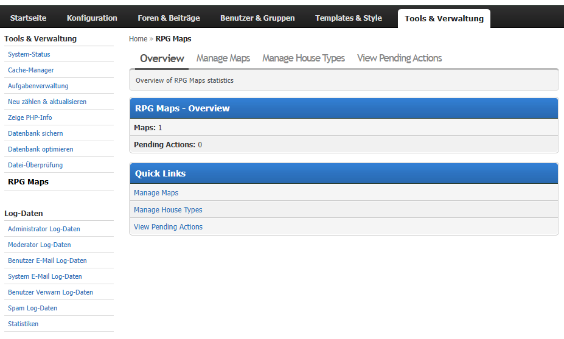
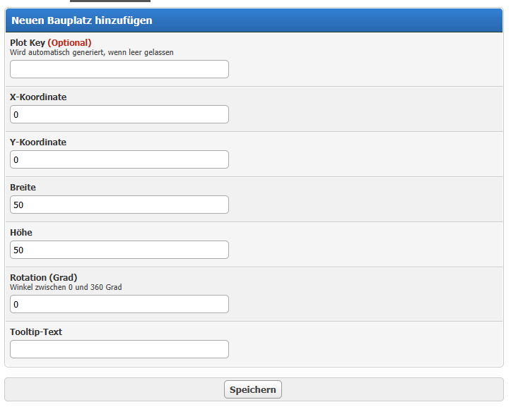
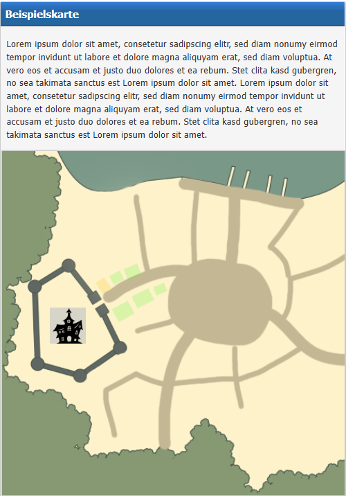
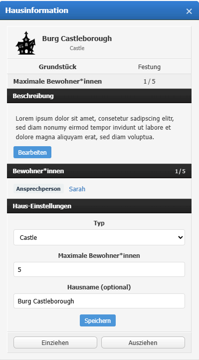

# RPG Maps – Interactive Maps for MyBB 1.8

RPG Maps adds interactive, image-based city maps to RPG forums. The team draws building plots onto a map; members claim free plots with a build request, and once the team approves it the house appears on the map. Members can move into existing houses, move out again and maintain their house's name and description.

## Requirements

- MyBB 1.8.x
- PHP 7.4 or 8.x
- MySQL 5.7+ or MariaDB 10.4+ (the tables use InnoDB and foreign keys)
- **Optional:** [MyAlerts](https://github.com/MyBBStuff/MyAlerts) – sends an alert when a build request is approved

## Installation

1. Upload all files to your MyBB root directory, keeping the folder structure.
2. Make sure `inc/plugins/rpgmaps/assets/maps/` and `inc/plugins/rpgmaps/assets/houses/` are writable by the web server (uploaded images are stored there).
3. **ACP → Configuration → Plugins → RPG Maps → Install & Activate.**
   This creates the tables and settings, loads the templates and the `rpgmaps.css` stylesheet and adds a **Maps** link to the header menu.
4. **ACP → Configuration → Settings → RPG Maps Plugin** – check the settings (see [Configuration](#configuration)).
5. If your admin groups use restricted permissions: **ACP → Users & Groups → Admin Permissions → Tools & Maintenance → Can manage RPG Maps?**

> If your theme uses a heavily customised `header` template, the menu link may be placed before the first `</ul>` instead of next to *Search*. You can move `{$rpgmaps_nav}` anywhere in the `header` template.

## Usage

### 1. Create house types

**ACP → Tools & Maintenance → RPG Maps → House types → Add house type**

- **Name** – shown in the build form and on the map (e.g. *Cottage*, *Town house*).
- **Description** – internal note.
- **Image** – the house graphic placed on the plot once it is built (PNG, JPG, GIF, WebP).
- **Icon scale** – scale factor for the house graphic.

A house type can only be deleted while no house uses it.

### 2. Create a map

**ACP → Tools & Maintenance → RPG Maps → Maps → Add map**

- **Title** and **Description** – shown on the map page.
- **Width / Height (px)** – the original size of the map image. All plot coordinates refer to this size; the browser scales map and plots automatically to the available width.
- **Map image** – the map graphic.

### 3. Add plots

**Maps → Options → Manage plots → Add plot**

- **Plot key** – unique per map; generated automatically if left empty.
- **X / Y position, Width, Height** – pixel values relative to the original map size. Width and height are capped by the *Maximum Plot Size* setting.
- **Rotation** – 0–359 degrees.
- **Label** – shown when hovering the plot.

### 4. Members: build, move in, move out

The **Maps** link in the header leads to `rpgmaps.php` with a list of all maps. On a map, plots are colour-coded:

- **Free (green)** – logged-in members click it, choose a house type, the maximum number of residents (1–20) and optionally a house name and description, and submit a **build request**.
- **Requested (yellow)** – a build request is waiting for the team.
- **Built** – shows the house graphic. Clicking it opens the house information: type, name, description (MyCode), residents and free places.

In a built house:

- **Move in** – any logged-in member can move in immediately as long as there is a free place.
- **Move out** – residents can move out immediately. When the last resident leaves, the house is removed and the plot becomes free again.
- **Edit** – residents can change the description and the house settings (type, maximum residents, name). The maximum cannot be set below the current number of residents.

### 5. Team: approve build requests

Pending build requests can be handled in two places:

- **ModCP → RPG Maps** – list with member, map/plot and date, plus *Approve* / *Reject* buttons. The ModCP menu entry shows the number of pending requests.
- **ACP → Tools & Maintenance → RPG Maps → Build requests** – the same list with an options menu.

Team members with ModCP or ACP access also see a notice on the forum index while requests are pending.

When a request is approved, the house is created, the requesting member becomes its contact person and – if MyAlerts is installed – receives an alert. A request is rejected automatically if the plot was taken in the meantime or the house type no longer exists.

### Automatic clean-up

When an account is deleted (any deletion path: ACP, bulk delete, merge), the member is removed from all houses, their pending build requests are dropped, and houses that end up without residents are removed so the plots become free.

## Configuration

**ACP → Configuration → Settings → RPG Maps Plugin**

| Setting | Description | Default |
|---------|-------------|---------|
| Enable RPG Maps Plugin | Turns the map pages and the header link on or off | Yes |
| Maximum Plot Size | Upper limit for plot width and height in pixels (0 = no limit) | 200 |
| Maximum Upload Size (KB) | Maximum file size for map and house images | 512 |
| Allowed File Extensions | Comma-separated list; the file's MIME type must also match the extension (png, jpg/jpeg, gif, webp) | png,jpg,jpeg,gif |

## Updating

1. Upload the new files and overwrite the existing ones.
2. **ACP → Configuration → Plugins → RPG Maps → Deactivate**, then **Activate**.

Activating again runs the database migrations, adds new settings and reloads the templates and the stylesheet. Your maps, houses and settings are kept. Templates you customised per theme are replaced by the new versions.

## Uninstallation

**ACP → Configuration → Plugins → RPG Maps → Uninstall.** This removes all tables, settings, templates, the stylesheet, the header link and the MyAlerts alert type. Uploaded images in `inc/plugins/rpgmaps/assets/maps/` and `…/houses/` are kept; delete them manually if no longer needed.

## Changelog

See [CHANGELOG.md](CHANGELOG.md).
